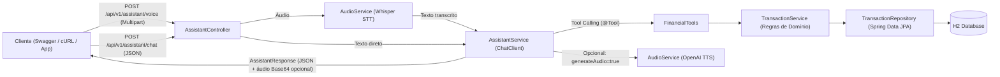

# Smart Budget Spring AI

API de **Orçamento e Finanças Pessoais Inteligente** desenvolvida com **Java 21**, **Spring Boot 3.4** e **Spring AI 1.0**, capaz de interpretar comandos em **voz e texto natural**, executar funções Java diretamente no banco de dados via **Tool Calling (Function Calling)** e responder como um Consultor Financeiro Pessoal.

> Projeto desenvolvido como desafio final da trilha de Spring Boot da **DIO**, evoluído com boas práticas de arquitetura, validações de domínio, tratamento global de erros e suíte completa de testes automatizados.

---

## O que o projeto faz e Arquitetura do Fluxo

O usuário interage com a API enviando **um áudio** (ex.: *"Gastei 85 reais no almoço hoje"* ou *"Como está meu saldo?"*) ou **uma mensagem de texto**. O Spring AI transcreve o áudio quando necessário, interpreta a intenção por meio de um System Prompt especializado e aciona automaticamente ferramentas Java (`FinancialTools`) conectadas ao banco em memória **H2**.



### Fluxo completo passo a passo
1. **Entrada (Voz ou Texto):** O `AssistantController` recebe um arquivo de áudio em `/api/v1/assistant/voice` ou um JSON em `/api/v1/assistant/chat`.
2. **Speech-to-Text (STT):** No fluxo de voz, o `AudioService` envia o recurso de áudio para o `OpenAiAudioTranscriptionModel` (`whisper-1`) configurado para português (`pt`).
3. **Orquestração com `ChatClient` + Tool Calling:** O `AssistantService` envia o comando para o `ChatClient` com um *System Prompt* de Consultor Financeiro Pessoal e as ferramentas do `FinancialTools` registradas:
   - `registrarTransacao`: valida e persiste receitas (`INCOME`) e despesas (`EXPENSE`).
   - `listarTransacoesPorCategoria`: filtra lançamentos por categoria e/ou tipo.
   - `calcularResumoFinanceiro`: consolida receitas, despesas, saldo líquido e dispara alerta caso as despesas superem as receitas.
4. **Persistência e Auditoria:** O `TransactionService` aplica as regras de domínio e persiste via `TransactionRepository` no H2. Os dados também podem ser auditados diretamente via `GET /api/v1/transactions` e `GET /api/v1/transactions/summary`.
5. **Resposta (Texto + TTS opcional):** O assistente devolve uma resposta estruturada em português e, se `generateAudio=true`, o `AudioService` gera o áudio MP3 via `OpenAiAudioSpeechModel` (`tts-1`) retornado em Base64.

---

## Evoluções Implementadas Além do Projeto Base

| Evolução | Descrição Técnica |
| :--- | :--- |
| **Resumo Financeiro via Tool Calling** | Implementação da ferramenta `calcularResumoFinanceiro` em `FinancialTools`, calculando total de receitas, total de despesas, saldo líquido e emitindo `deficitAlert` quando os gastos superam os ganhos. |
| **Validações de Domínio** | Regras na entidade `Transaction` e no `TransactionService` (além de Bean Validation nos DTOs) impedindo valores menores ou iguais a zero, descrições vazias ou categorias/tipos inválidos, lançando `InvalidTransactionException`. |
| **Endpoint Híbrido (Texto e Voz)** | Adição do endpoint `POST /api/v1/assistant/chat` para testes imediatos via Swagger UI ou cURL sem necessidade de upload de áudio, além do suporte opcional a resposta falada (`generateAudio=true`). |
| **Tratamento Global de Erros** | `@RestControllerAdvice` (`GlobalExceptionHandler`) padronizando erros no record `ApiErrorResponse` com semântica HTTP precisa: `400 Bad Request` (validação sintática e formato de áudio), `422 Unprocessable Entity` (regras de negócio / domínio), `502 Bad Gateway` (falha de comunicação/autenticação com a OpenAI) e `500 Internal Server Error`. |
| **Configuração Resiliente & Testes Offline** | Fallback `OPENAI_API_KEY:demo-key` no `application.yml` para inicializar a aplicação sem chave real e suíte com `@SpringBootTest` + Mockito testando as Tools, regras de domínio, `@RestControllerAdvice` e controllers sem consumir créditos da OpenAI. |

---

## Tecnologias Utilizadas

- **Java 21** (Records, Text Blocks, Pattern Matching)
- **Spring Boot 3.4.5** (Web, Data JPA, Validation)
- **Spring AI 1.0.0** (`spring-ai-starter-model-openai`, `ChatClient`, `@Tool` / `@ToolParam`, `OpenAiAudioTranscriptionModel`, `OpenAiAudioSpeechModel`)
- **H2 Database** (Banco relacional em memória + H2 Console)
- **Springdoc OpenAPI 2.8.6** (Swagger UI)
- **JUnit 5, Mockito & MockMvc** (Testes unitários e de integração)
- **Maven** com Spring AI BOM (`spring-ai-bom`)

---

## Estrutura do Projeto

```text
src/main/java/br/com/devlopes/smartbudget
├── config
│   └── OpenApiConfig.java
├── controller
│   ├── AssistantController.java
│   └── TransactionController.java
├── dto
│   ├── ApiErrorResponse.java
│   ├── AssistantResponse.java
│   ├── ChatRequest.java
│   ├── FinancialSummaryResponse.java
│   ├── TransactionRequest.java
│   └── TransactionResponse.java
├── exception
│   ├── AudioProcessingException.java
│   ├── GlobalExceptionHandler.java
│   └── InvalidTransactionException.java
├── model
│   ├── Transaction.java
│   ├── TransactionCategory.java
│   └── TransactionType.java
├── repository
│   ├── TransactionRepository.java
│   └── TypeAggregate.java
├── service
│   ├── AssistantService.java
│   ├── AudioService.java
│   └── TransactionService.java
├── tools
│   └── FinancialTools.java
└── SmartBudgetAiApplication.java
```

---

## Como Executar a Aplicação

### Pré-requisitos
- **Java 21** instalado
- **Maven 3.9+** instalado
- Uma chave da OpenAI (`OPENAI_API_KEY`) para chamadas reais de IA *(opcional para subir a aplicação ou rodar os testes automatizados)*

### 1. Executar os testes automatizados (sem API Key)
```bash
mvn test
```

### 2. Subir a aplicação localmente
Sem variável de ambiente (usa o fallback `demo-key`, ideal para inspecionar Swagger, H2 e endpoints REST):
```bash
mvn spring-boot:run
```

Com uma chave real da OpenAI (para testar transcrição, ChatClient com Tool Calling e TTS ao vivo):
```powershell
# Windows PowerShell
$env:OPENAI_API_KEY="sk-sua-chave-aqui"
mvn spring-boot:run
```
```bash
# Linux / macOS
export OPENAI_API_KEY="sk-sua-chave-aqui"
mvn spring-boot:run
```

### 3. Acessar Interface Web, Swagger UI e Console H2
- **Painel Web Interativo:** http://localhost:8080/ *(dashboard financeiro, cadastro manual, chat e gravação de voz pelo microfone)*
- **Swagger UI:** http://localhost:8080/swagger-ui.html
- **Console H2:** http://localhost:8080/h2-console (JDBC URL: `jdbc:h2:mem:smartbudgetdb`, User: `sa`, Password vazio)

---

## Como Testar o Fluxo Principal (Swagger / cURL)

### 1. Comando por Texto (`POST /api/v1/assistant/chat`)
```bash
curl -X POST http://localhost:8080/api/v1/assistant/chat \
  -H "Content-Type: application/json" \
  -d '{
    "message": "Recebi meu salário de 5500 reais hoje e gastei 120 reais com almoço",
    "generateAudio": false
  }'
```

### 2. Comando por Voz (`POST /api/v1/assistant/voice`)
```bash
curl -X POST "http://localhost:8080/api/v1/assistant/voice?generateAudio=false" \
  -F "audio=@comando.mp3"
```

### 3. Auditoria Direta no Banco H2 (`GET /api/v1/transactions` e `/summary`)
```bash
# Listar todas as transações (ou filtrar com ?category=FOOD&type=EXPENSE)
curl http://localhost:8080/api/v1/transactions

# Consultar resumo financeiro consolidado e alerta de déficit
curl http://localhost:8080/api/v1/transactions/summary
```

### 4. Testando Validações e `@RestControllerAdvice` (`POST /api/v1/transactions`)
```bash
curl -X POST http://localhost:8080/api/v1/transactions \
  -H "Content-Type: application/json" \
  -d '{
    "description": "",
    "amount": -10,
    "type": "EXPENSE",
    "category": "FOOD"
  }'
```

---

## Aprendizados Técnicos Durante o Desafio

- **Tool Calling declarativo no Spring AI 1.0:** Uso de `@Tool` e `@ToolParam` para expor métodos Java tipados diretamente ao `ChatClient`, permitindo que o modelo decida quando registrar, filtrar ou consolidar dados financeiros sem acoplamento no controller.
- **Unificação de fluxos multimodais:** Integração entre `OpenAiAudioTranscriptionModel` (STT), `ChatClient` e `OpenAiAudioSpeechModel` (TTS) sob uma arquitetura limpa de serviços.
- **Defesa em profundidade nas validações:** Combinar Bean Validation na borda REST com invariantes de domínio na entidade/serviço garante que tanto chamadas HTTP diretas quanto parâmetros gerados pela IA sejam validados antes da persistência.
- **Testabilidade de aplicações com IA generativa:** Uso de `@MockitoBean` sobre `ChatModel`, `OpenAiAudioTranscriptionModel` e `OpenAiAudioSpeechModel` para validar todo o contexto Spring Boot, JPA/H2 e `MockMvc` sem depender de rede ou créditos externos.
