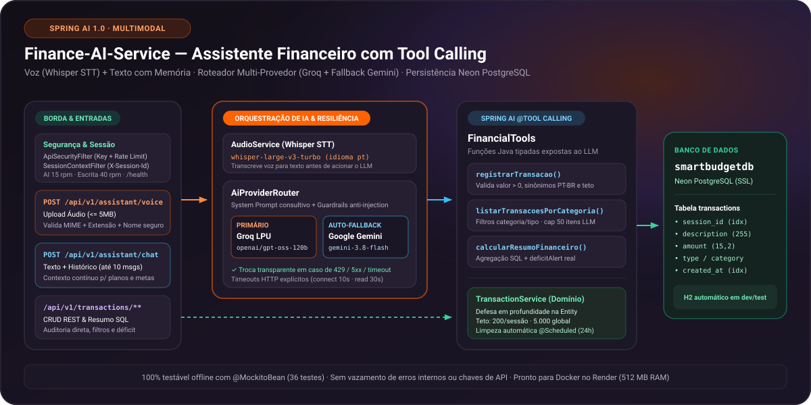

<div align="center">

# Finance-AI-Service — Consultor Financeiro Multimodal com Spring AI

**Microsserviço Java 21 / Spring Boot 3.4 + Spring AI 1.0 capaz de interpretar comandos de voz (Whisper STT) e texto com memória de conversa, acionar ferramentas Java diretamente no PostgreSQL via Tool Calling e rotear entre Groq e Google Gemini com fallback automático.**

[](https://openjdk.org/)
[](https://spring.io/projects/spring-boot)
[](https://spring.io/projects/spring-ai)
[](https://neon.tech/)
[](#testes-automatizados)

<br />


</div>

> Este microsserviço integra o ecossistema do **Bootcamp Java & IA (Itaú + DIO)**, consumido server-side pelo portal BFF **[ItauBootcamp](https://github.com/GabrielVSL/ItauBootcamp)** em conjunto com o **[CheckoutService](https://github.com/GabrielVSL/CheckoutService)**.

---

## Arquitetura do Fluxo Multimodal & Tool Calling

<p align="center">
  
</p>

### Por que escolhi esta arquitetura?

| Decisão Arquitetural | Motivação e Trade-off |
| :--- | :--- |
| **Roteador Multi-Provedor com Fallback Automático ([`AiProviderRouter`](src/main/java/br/com/devlopes/smartbudget/service/AiProviderRouter.java))** | Depender de um único provedor pago (OpenAI) cria ponto único de falha e custo. O serviço utiliza a especificação OpenAI-compatível do Spring AI para rodar **Groq LPU** (`openai/gpt-oss-120b` + `whisper-large-v3-turbo` para voz) como primário e **Google Gemini** (`gemini-3.8-flash`) como fallback automático em caso de `429`, erro transiente ou indisponibilidade — tudo 100% gratuito para portfólio. |
| **Tool Calling Tipado (`@Tool`) em vez de Prompts Frágeis** | Em vez de pedir ao LLM que devolva JSON manual e parsear regex no controller, os métodos de [`FinancialTools`](src/main/java/br/com/devlopes/smartbudget/tools/FinancialTools.java) (`registrarTransacao`, `listarTransacoesPorCategoria`, `calcularResumoFinanceiro`) são expostos com schemas tipados. A IA nunca inventa saldo: ela consulta agregação SQL real no banco antes de responder ou montar planos financeiros. |
| **Defesa em Profundidade (DTO + Entidade + Prompt)** | Como chamadas podem vir tanto via REST direto quanto via argumentos gerados pelo LLM, as invariantes (valor > 0, teto de R$ 10M, tamanho da descrição, sinônimos PT-BR e teto por sessão) são validadas tanto nos DTOs quanto dentro de [`Transaction.validate()`](src/main/java/br/com/devlopes/smartbudget/model/Transaction.java). |
| **Memória de Conversa Stateless via Histórico Validado** | Para que o usuário peça *"Quero juntar para uma casa, monte um plano"* e continue refinando valores nas mensagens seguintes sem acoplar sessão de chat em RAM do servidor, [`ChatRequest`](src/main/java/br/com/devlopes/smartbudget/dto/ChatRequest.java) aceita até 10 mensagens de contexto (truncadas a 600 chars) convertidas em `UserMessage`/`AssistantMessage` do Spring AI. |
| **Banco Híbrido (Neon PostgreSQL em prod · H2 em dev/test)** | Sem variáveis externas, o Spring Boot sobe instantaneamente com H2 em memória para testes 100% offline. Em produção no Render, basta informar `SPRING_DATASOURCE_URL` apontando para `smartbudgetdb` no Neon (SSL + pool HikariCP ajustado para *scale-to-zero*). |

---

## Desafios Reais Enfrentados e Como Foram Resolvidos

1. **Descontinuação de Modelos em Provedores Gratuitos (Groq & Gemini)**
   - **Problema:** Durante o deploy real em produção, modelos clássicos (`llama-3.3-70b-versatile` no Groq free tier e `gemini-2.5-flash` em contas novas do Google) passaram a retornar `404 model_not_found`.
   - **Solução:** Como os modelos são externalizados via variáveis (`AI_CHAT_MODEL` e `GEMINI_CHAT_MODEL`), foi possível migrar imediatamente para `openai/gpt-oss-120b` (Groq) e `gemini-3.8-flash` (Gemini) sem reescrever a integração, mantendo `whisper-large-v3-turbo` (`200 OK` em ~114ms) para transcrição de voz.

2. **Segurança em Upload de Áudio e Proteção Contra *Denial of Wallet***
   - **Problema:** Endpoints públicos de IA são alvo frequente de abuso de cota de API, uploads de arquivos falsos sem extensão ou path traversal no `originalFilename` encaminhado ao provedor externo.
   - **Solução:**
     - [`ApiSecurityFilter`](src/main/java/br/com/devlopes/smartbudget/config/ApiSecurityFilter.java) exige `X-Internal-Api-Key` (comparação em tempo constante), aplica rate limit específico para IA (`15 req/min`), limita corpo JSON (`64 KB`) e bloqueia CORS aberto por padrão.
     - [`AudioService`](src/main/java/br/com/devlopes/smartbudget/service/AudioService.java) valida tamanho (`<= 5 MB`), tipo MIME, obriga extensão suportada e **descarta o `originalFilename` do usuário**, encapsulando o binário com nome fixo seguro `audio.<ext>`.

3. **Vazamento de Erros Internos e Prompt Injection**
   - **Problema:** Exceções de provedores externos (`NonTransientAiException`) ou Jackson podem conter trechos de chave, URLs internas ou nomes de pacotes Java.
   - **Solução:** [`GlobalExceptionHandler`](src/main/java/br/com/devlopes/smartbudget/exception/GlobalExceptionHandler.java) grava o detalhe técnico exclusivamente nos logs do servidor e devolve contratos limpos (`400`, `413`, `422`, `502`, `500`). O `SYSTEM_PROMPT` traz guardrails explícitos contra tentativas de vazamento de prompt/chaves ou cadastros em massa, e `listarTransacoesPorCategoria` limita o retorno ao LLM a 50 registros para evitar estouro de contexto.

4. **Proteção de Recursos em Ambiente Gratuito (Render 512 MB)**
   - Limite de `200` transações por sessão e `5.000` globais em [`TransactionService`](src/main/java/br/com/devlopes/smartbudget/service/TransactionService.java), limpeza agendada `@Scheduled` a cada hora (retenção de 24h), console H2 e Swagger desabilitados por padrão (`false`) e [`Dockerfile`](Dockerfile) multi-stage não-root com `-XX:MaxRAMPercentage=70.0 -XX:+UseSerialGC`.

---

## Endpoints da API

| Método | Rota | Descrição |
| :---: | :--- | :--- |
| `GET` | `/health` | Health check leve para Render/monitoramento (não consulta banco) |
| `POST` | `/api/v1/assistant/chat` | Envia comando em linguagem natural (aceita `history` e `provider` opcionais) |
| `POST` | `/api/v1/assistant/voice` | Recebe áudio multipart (`mp3`, `wav`, `m4a`, `webm`, `ogg`, `flac`), transcreve via Whisper e executa o consultor IA |
| `GET` | `/api/v1/assistant/providers` | Lista provedores suportados (`groq` e `gemini`), modelos ativos e suporte a voz |
| `GET` | `/api/v1/transactions` | Lista lançamentos da sessão (`X-Session-Id`) com filtros opcionais `category` e `type` |
| `GET` | `/api/v1/transactions/summary` | Agregação SQL: receitas, despesas, saldo líquido e `deficitAlert` |
| `POST` | `/api/v1/transactions` | Cadastro manual de receita/despesa |
| `DELETE` | `/api/v1/transactions` | Limpa apenas as transações pertencentes à sessão atual |

---

## Como Executar Localmente e em Produção

### Localmente (H2 em memória — funciona até sem chave de IA nos testes)
```bash
git clone https://github.com/GabrielVSL/Finance-AI-Service.git
cd Finance-AI-Service

# Rodar os 36 testes 100% offline (sem API key nem banco externo)
mvn test

# Subir na porta 8080 com chave grátis do Groq (Chat + Voz) e/ou Gemini (Fallback)
# PowerShell:
$env:AI_API_KEY="gsk_sua_chave_groq"
$env:GEMINI_API_KEY="sua_chave_gemini_opcional"
mvn spring-boot:run
```

> Para habilitar Swagger ou H2 Console **somente em desenvolvimento local**, defina `SWAGGER_ENABLED=true` / `H2_CONSOLE_ENABLED=true`.

### Produção (Docker no Render + Neon PostgreSQL)
Configure as variáveis descritas em [`.env.example`](.env.example) no Render (`Runtime: Docker`, `Health Check Path: /health`):
- `SPRING_DATASOURCE_URL=jdbc:postgresql://<host-neon>/smartbudgetdb?sslmode=require`
- `SPRING_DATASOURCE_USERNAME` / `SPRING_DATASOURCE_PASSWORD`
- `AI_API_KEY` (Groq) e opcionalmente `GEMINI_API_KEY` (Google AI Studio)
- `INTERNAL_API_KEY` *(mesmo valor configurado no BFF)* e `TRUST_PROXY_HEADERS=true`

---

## Testes Automatizados

A suíte executa **36 testes 100% offline** (JUnit 5, Mockito, MockMvc e `@MockitoBean` para os clientes de IA):
- [`SmartBudgetApiIntegrationTest`](src/test/java/br/com/devlopes/smartbudget/controller/SmartBudgetApiIntegrationTest.java): endpoints REST, chat, voz, isolamento por `X-Session-Id`, CORS explícito, validação de áudio sem extensão, limite de caracteres e garantia de não vazamento em erro `502`.
- [`ApiSecurityFilterTest`](src/test/java/br/com/devlopes/smartbudget/config/ApiSecurityFilterTest.java): autenticação `X-Internal-Api-Key`, liberação de `/health` e rate limiting (`429` + `Retry-After`).
- [`FinancialToolsIntegrationTest`](src/test/java/br/com/devlopes/smartbudget/tools/FinancialToolsIntegrationTest.java): execução real das `@Tool` no H2, sinônimos em português e detecção de `deficitAlert`.
- [`AiProviderRouterTest`](src/test/java/br/com/devlopes/smartbudget/service/AiProviderRouterTest.java), [`AudioServiceTest`](src/test/java/br/com/devlopes/smartbudget/service/AudioServiceTest.java) e [`TransactionServiceTest`](src/test/java/br/com/devlopes/smartbudget/service/TransactionServiceTest.java): roteamento, fallback, validação de mídia e regras financeiras.
